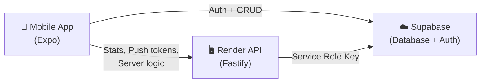
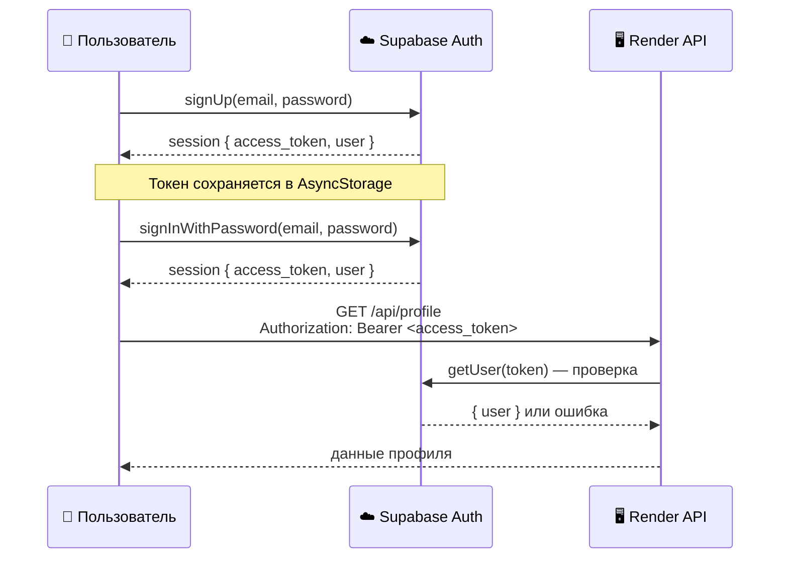

# 📚 Do-Daily — Полная API Документация

> [!IMPORTANT]
> В проекте используются **два канала** для работы с данными:
> 1. **Supabase Client (напрямую из приложения)** — для авторизации и CRUD задач/профиля
> 2. **Render API (Fastify бэкенд)** — для push-уведомлений, статистики и серверной логики

---

## 🏗️ Архитектура запросов



## 🔐 Авторизация — как это работает



---

## 📋 Часть 1: Supabase Client (из приложения)

**URL проекта:** `https://doipqjhkutoosfixiqat.supabase.co`

Supabase Client используется **напрямую** из мобильного приложения. Все запросы автоматически подписываются `anon key` и `access_token` текущего пользователя.

### 1.1 Авторизация

#### Регистрация

```typescript
import { supabase } from '../api/supabase'

const { data, error } = await supabase.auth.signUp({
  email: 'user@example.com',
  password: 'mypassword123',
  options: {
    data: {
      name: 'Абдулбосит',   // → попадёт в raw_user_meta_data
    },
  },
})

// data.user — объект пользователя (id, email, aud, ...)
// data.session — сессия (access_token, refresh_token, ...)
// error — null если успех, иначе { message, status }
```

> [!NOTE]
> При регистрации автоматически срабатывает **триггер** `handle_new_user()`, который создаёт запись в таблице `profiles` с `name` из `raw_user_meta_data` (или имя из email до `@`).

#### Вход

```typescript
const { data, error } = await supabase.auth.signInWithPassword({
  email: 'user@example.com',
  password: 'mypassword123',
})

if (error) {
  // error.message примеры:
  // "Invalid login credentials"      — неверный email/пароль
  // "Email not confirmed"            — email не подтверждён
  // "Too many requests"              — лимит попыток
}
```

#### Выход

```typescript
await supabase.auth.signOut()
// Сессия удаляется из AsyncStorage
```

#### Получить текущую сессию

```typescript
const { data: { session } } = await supabase.auth.getSession()
// session?.access_token — JWT токен для Render API
// session?.user — текущий пользователь
```

#### Слушать изменения авторизации

```typescript
supabase.auth.onAuthStateChange((event, session) => {
  // event: 'SIGNED_IN' | 'SIGNED_OUT' | 'TOKEN_REFRESHED' | ...
  // session: Session | null
})
```

---

### 1.2 Профили (`profiles`)

| Колонка                | Тип          | Описание                           |
|------------------------|--------------|-------------------------------------|
| `id`                   | `uuid` (PK)  | = `auth.users.id`                  |
| `name`                 | `text`        | Имя пользователя                  |
| `email`                | `text`        | Email (для удобства)               |
| `bio`                  | `text`        | О себе                             |
| `avatar_emoji`         | `text`        | Эмодзи аватара (по умолчанию ⚡)  |
| `daily_goal`           | `int`         | Цель на день (1–50, по умолч. 5)  |
| `notifications_enabled`| `boolean`    | Уведомления вкл/выкл              |
| `sounds_enabled`       | `boolean`     | Звуки вкл/выкл                    |
| `expo_push_token`      | `text`        | Токен для push-уведомлений        |
| `xp`                   | `int`         | Очки опыта                        |
| `streak`               | `int`         | Серия дней                         |
| `created_at`           | `timestamptz` | Дата создания                      |
| `updated_at`           | `timestamptz` | Автоматически обновляется          |

> [!TIP]
> RLS-политика: пользователь может **читать и обновлять только свой профиль** (`auth.uid() = id`).

#### Получить профиль

```typescript
const { data, error } = await supabase
  .from('profiles')
  .select('*')
  .eq('id', user.id)
  .single()

// data = { id, name, email, bio, avatar_emoji, daily_goal, xp, streak, ... }
```

#### Обновить профиль

```typescript
const { data, error } = await supabase
  .from('profiles')
  .update({
    name: 'Новое имя',
    avatar_emoji: '🚀',
    daily_goal: 10,
  })
  .eq('id', user.id)
  .select()
  .single()
```

---

### 1.3 Задачи (`tasks`)

| Колонка     | Тип             | Описание                              |
|-------------|-----------------|---------------------------------------|
| `id`        | `uuid` (PK)      | Автогенерация                        |
| `user_id`   | `uuid` (FK)      | Ссылка на `profiles.id`             |
| `title`     | `text`           | Название задачи                      |
| `description`| `text`          | Описание                             |
| `category`  | `task_category`  | `'health'`, `'study'`, `'personal'`  |
| `status`    | `task_status`    | `'pending'`, `'completed'`, `'failed'`|
| `start_at`  | `timestamptz`    | Начало задачи                        |
| `end_at`    | `timestamptz`    | Конец задачи (≥ start_at)           |
| `created_at`| `timestamptz`    | Дата создания                        |
| `updated_at`| `timestamptz`    | Автообновление                       |

> [!TIP]
> RLS-политики: SELECT, INSERT, UPDATE, DELETE — только для своих задач (`auth.uid() = user_id`).

#### Получить все задачи

```typescript
const { data, error } = await supabase
  .from('tasks')
  .select('*')
  .eq('user_id', user.id)
  .order('start_at', { ascending: true })

// data = [{ id, title, description, category, status, start_at, end_at, ... }, ...]
```

#### Задачи за конкретную дату

```typescript
const dateStart = '2026-11-15T00:00:00.000Z'
const dateEnd   = '2026-11-15T23:59:59.999Z'

const { data } = await supabase
  .from('tasks')
  .select('*')
  .eq('user_id', user.id)
  .gte('start_at', dateStart)
  .lte('start_at', dateEnd)
  .order('start_at', { ascending: true })
```

#### Задачи по категории и статусу

```typescript
const { data } = await supabase
  .from('tasks')
  .select('*')
  .eq('user_id', user.id)
  .eq('category', 'health')
  .eq('status', 'pending')
```

#### Создать задачу

```typescript
const { data, error } = await supabase
  .from('tasks')
  .insert({
    user_id: user.id,
    title: 'Утренняя пробежка',
    description: '30 минут в парке',
    category: 'health',
    status: 'pending',
    start_at: '2026-11-16T07:00:00.000Z',
    end_at:   '2026-11-16T07:30:00.000Z',
  })
  .select()
  .single()
```

#### Обновить задачу (пометить выполненной)

```typescript
const { data, error } = await supabase
  .from('tasks')
  .update({ status: 'completed' })
  .eq('id', taskId)
  .eq('user_id', user.id)    // RLS гарантирует безопасность
  .select()
  .single()
```

#### Удалить задачу

```typescript
const { error } = await supabase
  .from('tasks')
  .delete()
  .eq('id', taskId)
  .eq('user_id', user.id)
```

---

### 1.4 Достижения

#### Таблица `achievements` (справочник)

| Колонка       | Тип    | Описание            |
|---------------|--------|----------------------|
| `id`          | `text` | Уникальный ключ     |
| `title`       | `text` | Название             |
| `description` | `text` | Описание             |
| `icon`        | `text` | Иконка (Ionicons)   |
| `color`       | `text` | Цвет                 |
| `target_count`| `int`  | Сколько нужно выполнить |

#### Предустановленные достижения

| ID           | Название      | Цель  |
|--------------|---------------|-------|
| `first_step` | Первый шаг    | 1 задача |
| `on_fire`    | В ударе       | 5 задач  |
| `scholar`    | Знаток        | 3 учебные задачи |
| `champion`   | Чемпион       | 10 задач |

```typescript
// Получить все достижения (публичная таблица)
const { data } = await supabase
  .from('achievements')
  .select('*')

// Получить разблокированные достижения пользователя
const { data } = await supabase
  .from('user_achievements')
  .select('*, achievements(*)')
  .eq('user_id', user.id)

// Разблокировать достижение
const { error } = await supabase
  .from('user_achievements')
  .insert({
    user_id: user.id,
    achievement_id: 'first_step',
  })
```

---

## 📋 Часть 2: Render API (Fastify бэкенд)

**Base URL:** `https://do-daily-backend.onrender.com`

> [!WARNING]
> Render на бесплатном плане **засыпает через 15 минут** бездействия. Первый запрос после сна может занять 30–60 секунд. Для критичных операций (CRUD задач, авторизация) используйте **Supabase Client напрямую**.

### 2.1 Аутентификация запросов

Все защищённые эндпоинты требуют **Bearer Token** в заголовке `Authorization`. Токен — это `access_token` из сессии Supabase:

```typescript
import { supabase } from '../api/supabase'

const { data: { session } } = await supabase.auth.getSession()
const token = session?.access_token

// Пример запроса с fetch
const response = await fetch('https://do-daily-backend.onrender.com/api/profile', {
  method: 'GET',
  headers: {
    'Content-Type': 'application/json',
    'Authorization': `Bearer ${token}`,
  },
})
```

> [!CAUTION]
> Если токен истёк или невалиден, все защищённые эндпоинты вернут:
> ```json
> { "statusCode": 401, "error": "Unauthorized", "message": "Invalid or expired authentication token" }
> ```

---

### 2.2 Эндпоинты

#### 🟢 Health Check (без авторизации)

| Метод | URL | Авторизация |
|-------|-----|-------------|
| `GET` | `/health` | ❌ Не нужна |
| `GET` | `/` | ❌ Не нужна |
| `HEAD` | `/` | ❌ Не нужна |

**Ответ** `200 OK`:
```json
{
  "status": "ok",
  "service": "do-daily-backend",
  "timestamp": "2026-11-15T14:30:00.000Z",
  "uptimeSeconds": 3600
}
```

**curl:**
```bash
curl https://do-daily-backend.onrender.com/health
```

---

#### 👤 Профиль

##### GET /api/profile

Получить профиль текущего пользователя.

| Параметр | Значение |
|----------|----------|
| Метод | `GET` |
| URL | `/api/profile` |
| Авторизация | ✅ Bearer Token |

**Ответ** `200 OK`:
```json
{
  "id": "a1b2c3d4-...",
  "name": "Абдулбосит",
  "email": "user@example.com",
  "bio": "",
  "avatar_emoji": "⚡",
  "daily_goal": 5,
  "notifications_enabled": true,
  "sounds_enabled": true,
  "expo_push_token": null,
  "xp": 105,
  "streak": 3,
  "created_at": "2026-11-15T10:00:00.000Z",
  "updated_at": "2026-11-15T14:30:00.000Z"
}
```

**Ошибки:**
| Код | Причина |
|-----|---------|
| 401 | Нет или невалидный токен |
| 404 | Профиль не найден |

**curl:**
```bash
curl -H "Authorization: Bearer YOUR_TOKEN" \
  https://do-daily-backend.onrender.com/api/profile
```

---

##### PUT /api/profile

Обновить профиль. Передайте только те поля, которые нужно изменить.

| Параметр | Значение |
|----------|----------|
| Метод | `PUT` |
| URL | `/api/profile` |
| Авторизация | ✅ Bearer Token |
| Content-Type | `application/json` |

**Тело запроса** (все поля необязательные):
```json
{
  "name": "Новое Имя",
  "bio": "Люблю продуктивность 🚀",
  "avatar_emoji": "🔥",
  "daily_goal": 10,
  "notifications_enabled": false,
  "sounds_enabled": true
}
```

**Валидация полей:**
| Поле | Тип | Ограничения |
|------|-----|-------------|
| `name` | `string` | 1–100 символов |
| `bio` | `string` | макс. 300 символов |
| `avatar_emoji` | `string` | макс. 10 символов |
| `daily_goal` | `number` | целое, 1–50 |
| `notifications_enabled` | `boolean` | — |
| `sounds_enabled` | `boolean` | — |

**Ответ** `200 OK`: обновлённый объект профиля

**curl:**
```bash
curl -X PUT \
  -H "Authorization: Bearer YOUR_TOKEN" \
  -H "Content-Type: application/json" \
  -d '{"name": "Новое Имя", "daily_goal": 7}' \
  https://do-daily-backend.onrender.com/api/profile
```

---

##### POST /api/profile/push-token

Зарегистрировать Expo Push Token для push-уведомлений.

| Параметр | Значение |
|----------|----------|
| Метод | `POST` |
| URL | `/api/profile/push-token` |
| Авторизация | ✅ Bearer Token |

**Тело запроса:**
```json
{
  "expo_push_token": "ExponentPushToken[xxxxxxxxxxxxxxxxxxxxxx]"
}
```

**Ответ** `200 OK`:
```json
{ "success": true, "message": "Push token registered successfully" }
```

**Как получить токен в приложении:**
```typescript
import * as Notifications from 'expo-notifications'

const token = (await Notifications.getExpoPushTokenAsync()).data
// → "ExponentPushToken[...]"
```

---

#### ✅ Задачи

##### GET /api/tasks

Получить список задач текущего пользователя с фильтрацией.

| Параметр | Значение |
|----------|----------|
| Метод | `GET` |
| URL | `/api/tasks` |
| Авторизация | ✅ Bearer Token |

**Query-параметры** (все необязательные):
| Параметр | Тип | Пример | Описание |
|----------|-----|--------|----------|
| `status` | `string` | `pending` | `'pending'` \| `'completed'` \| `'failed'` |
| `category` | `string` | `health` | `'health'` \| `'study'` \| `'personal'` |
| `startDate` | `ISO string` | `2026-11-15T00:00:00Z` | Задачи начиная с этой даты |
| `endDate` | `ISO string` | `2026-11-15T23:59:59Z` | Задачи до этой даты |

**Ответ** `200 OK`:
```json
[
  {
    "id": "uuid-1",
    "user_id": "user-uuid",
    "title": "Утренняя пробежка",
    "description": "30 минут в парке",
    "category": "health",
    "status": "pending",
    "start_at": "2026-11-16T07:00:00.000Z",
    "end_at": "2026-11-16T07:30:00.000Z",
    "created_at": "2026-11-15T20:00:00.000Z",
    "updated_at": "2026-11-15T20:00:00.000Z"
  }
]
```

**curl:**
```bash
# Все задачи
curl -H "Authorization: Bearer YOUR_TOKEN" \
  https://do-daily-backend.onrender.com/api/tasks

# Только pending задачи по здоровью
curl -H "Authorization: Bearer YOUR_TOKEN" \
  "https://do-daily-backend.onrender.com/api/tasks?status=pending&category=health"

# Задачи за конкретный день
curl -H "Authorization: Bearer YOUR_TOKEN" \
  "https://do-daily-backend.onrender.com/api/tasks?startDate=2026-11-15T00:00:00Z&endDate=2026-11-15T23:59:59Z"
```

---

##### POST /api/tasks

Создать новую задачу.

| Параметр | Значение |
|----------|----------|
| Метод | `POST` |
| URL | `/api/tasks` |
| Авторизация | ✅ Bearer Token |

**Тело запроса:**
```json
{
  "title": "Подготовить презентацию",
  "description": "Слайды для курса по математике",
  "category": "study",
  "start_at": "2026-11-16T14:00:00.000Z",
  "end_at": "2026-11-16T16:00:00.000Z"
}
```

**Валидация:**
| Поле | Обязат. | Тип | Ограничения |
|------|---------|-----|-------------|
| `title` | ✅ | `string` | 1–200 символов |
| `description` | ❌ | `string` | макс. 1000 символов (по умолч. `""`) |
| `category` | ❌ | `string` | `'health'` \| `'study'` \| `'personal'` (по умолч. `'study'`) |
| `start_at` | ✅ | `ISO datetime` | формат ISO 8601 |
| `end_at` | ✅ | `ISO datetime` | должен быть ≥ `start_at` |

**Ответ** `201 Created`: созданный объект задачи

**curl:**
```bash
curl -X POST \
  -H "Authorization: Bearer YOUR_TOKEN" \
  -H "Content-Type: application/json" \
  -d '{
    "title": "Подготовить презентацию",
    "category": "study",
    "start_at": "2026-11-16T14:00:00.000Z",
    "end_at": "2026-11-16T16:00:00.000Z"
  }' \
  https://do-daily-backend.onrender.com/api/tasks
```

---

##### PUT /api/tasks/:id

Обновить задачу. Передайте только поля для обновления.

| Параметр | Значение |
|----------|----------|
| Метод | `PUT` |
| URL | `/api/tasks/:id` |
| Авторизация | ✅ Bearer Token |

**URL-параметр:** `id` — UUID задачи

**Тело запроса** (все поля необязательные):
```json
{
  "title": "Обновлённое название",
  "status": "completed",
  "category": "personal"
}
```

> [!NOTE]
> При `status: "completed"` сервер автоматически начисляет **+35 XP** в профиль пользователя.

**Ответ** `200 OK`: обновлённый объект задачи

**curl:**
```bash
# Пометить задачу выполненной
curl -X PUT \
  -H "Authorization: Bearer YOUR_TOKEN" \
  -H "Content-Type: application/json" \
  -d '{"status": "completed"}' \
  https://do-daily-backend.onrender.com/api/tasks/TASK_UUID
```

---

##### DELETE /api/tasks/:id

Удалить задачу.

| Параметр | Значение |
|----------|----------|
| Метод | `DELETE` |
| URL | `/api/tasks/:id` |
| Авторизация | ✅ Bearer Token |

**Ответ** `200 OK`:
```json
{ "success": true, "message": "Task TASK_UUID deleted" }
```

**curl:**
```bash
curl -X DELETE \
  -H "Authorization: Bearer YOUR_TOKEN" \
  https://do-daily-backend.onrender.com/api/tasks/TASK_UUID
```

---

##### POST /api/tasks/clear-completed

Удалить все выполненные задачи пользователя.

| Параметр | Значение |
|----------|----------|
| Метод | `POST` |
| URL | `/api/tasks/clear-completed` |
| Авторизация | ✅ Bearer Token |

**Тело запроса:** не нужно

**Ответ** `200 OK`:
```json
{ "success": true, "deletedCount": 5 }
```

**curl:**
```bash
curl -X POST \
  -H "Authorization: Bearer YOUR_TOKEN" \
  https://do-daily-backend.onrender.com/api/tasks/clear-completed
```

---

#### 📊 Статистика

##### GET /api/stats/summary

Получить сводную статистику по всем задачам пользователя.

| Параметр | Значение |
|----------|----------|
| Метод | `GET` |
| URL | `/api/stats/summary` |
| Авторизация | ✅ Bearer Token |

**Ответ** `200 OK`:
```json
{
  "totalCount": 45,
  "completedCount": 30,
  "pendingCount": 10,
  "overdueCount": 5,
  "completionRate": 67,
  "categoryStats": [
    { "category": "health", "total": 15, "completed": 12, "percent": 80 },
    { "category": "study", "total": 20, "completed": 13, "percent": 65 },
    { "category": "personal", "total": 10, "completed": 5, "percent": 50 }
  ],
  "weekChart": [
    { "dayName": "Сб", "dayNumber": 9, "date": "2026-11-09", "total": 5, "completed": 3, "isToday": false },
    { "dayName": "Вс", "dayNumber": 10, "date": "2026-11-10", "total": 3, "completed": 2, "isToday": false },
    { "dayName": "Пн", "dayNumber": 11, "date": "2026-11-11", "total": 7, "completed": 5, "isToday": false },
    { "dayName": "Вт", "dayNumber": 12, "date": "2026-11-12", "total": 4, "completed": 4, "isToday": false },
    { "dayName": "Ср", "dayNumber": 13, "date": "2026-11-13", "total": 6, "completed": 3, "isToday": false },
    { "dayName": "Чт", "dayNumber": 14, "date": "2026-11-14", "total": 8, "completed": 6, "isToday": false },
    { "dayName": "Пт", "dayNumber": 15, "date": "2026-11-15", "total": 4, "completed": 2, "isToday": true }
  ]
}
```

**Описание полей:**
| Поле | Описание |
|------|----------|
| `totalCount` | Общее количество задач |
| `completedCount` | Выполненных задач |
| `pendingCount` | Активных (не просроченных) задач |
| `overdueCount` | Просроченных задач (`pending` + `end_at < сейчас`) |
| `completionRate` | Процент выполнения (0–100) |
| `categoryStats` | Статистика по каждой категории |
| `weekChart` | Данные за последние 7 дней для графика |

**curl:**
```bash
curl -H "Authorization: Bearer YOUR_TOKEN" \
  https://do-daily-backend.onrender.com/api/stats/summary
```

---

## 📋 Часть 3: Справочники

### 3.1 Коды ошибок (все эндпоинты)

| HTTP код | Значение | Когда |
|----------|----------|-------|
| `200` | OK | Успешный GET/PUT/DELETE |
| `201` | Created | Задача успешно создана |
| `400` | Bad Request | Невалидные данные (ошибка Zod валидации) |
| `401` | Unauthorized | Нет токена / невалидный / истёк |
| `404` | Not Found | Профиль или задача не найдены |
| `500` | Internal Server Error | Ошибка на сервере |

### 3.2 Enums (перечисления в базе данных)

```
task_category = 'health' | 'study' | 'personal'
task_status   = 'pending' | 'completed' | 'failed'
```

### 3.3 Фоновые процессы на сервере (Cron Jobs)

Сервер автоматически выполняет:

| Задача | Расписание | Описание |
|--------|------------|----------|
| Напоминания | Каждые 5 минут | Отправляет push-уведомления о задачах, начинающихся в ближайшие 5 минут |
| Ночная очистка | Ежедневно в 00:00 | Помечает просроченные `pending` задачи как `failed` |

---

## 📋 Часть 4: Примеры использования в приложении

### Полный цикл: Создать задачу → Отметить выполненной → Удалить

```typescript
import { supabase } from '../api/supabase'

// 1. Создать задачу
const { data: newTask } = await supabase
  .from('tasks')
  .insert({
    user_id: user.id,
    title: 'Пробежка',
    category: 'health',
    status: 'pending',
    start_at: new Date().toISOString(),
    end_at: new Date(Date.now() + 30 * 60000).toISOString(),
  })
  .select()
  .single()

console.log('Создана:', newTask.id)

// 2. Отметить выполненной
const { data: completed } = await supabase
  .from('tasks')
  .update({ status: 'completed' })
  .eq('id', newTask.id)
  .select()
  .single()

console.log('Статус:', completed.status) // 'completed'

// 3. Удалить
await supabase
  .from('tasks')
  .delete()
  .eq('id', newTask.id)
```

### Отправить запрос на Render API с авторизацией

```typescript
async function fetchFromAPI(endpoint: string, options?: RequestInit) {
  const { data: { session } } = await supabase.auth.getSession()

  if (!session?.access_token) {
    throw new Error('Пользователь не авторизован')
  }

  const response = await fetch(
    `https://do-daily-backend.onrender.com${endpoint}`,
    {
      ...options,
      headers: {
        'Content-Type': 'application/json',
        'Authorization': `Bearer ${session.access_token}`,
        ...options?.headers,
      },
    }
  )

  if (!response.ok) {
    const error = await response.json()
    throw new Error(error.message || `HTTP ${response.status}`)
  }

  return response.json()
}

// Использование:
const profile = await fetchFromAPI('/api/profile')
const stats = await fetchFromAPI('/api/stats/summary')
const updated = await fetchFromAPI('/api/profile', {
  method: 'PUT',
  body: JSON.stringify({ daily_goal: 8 }),
})
```

---

## 📋 Часть 5: Безопасность

> [!CAUTION]
> **Никогда не используйте** `SUPABASE_SERVICE_ROLE_KEY` в клиентском коде! Этот ключ обходит RLS и даёт полный доступ к базе. Он используется **только** на сервере (Render).

| Ключ | Где используется | Права |
|------|------------------|-------|
| `EXPO_PUBLIC_SUPABASE_ANON_KEY` | 📱 Мобильное приложение | Ограничены RLS |
| `SUPABASE_SERVICE_ROLE_KEY` | 🖥️ Render сервер | Полный доступ (обход RLS) |

### Как токен проходит через систему:

1. Пользователь логинится → Supabase возвращает `access_token` (JWT)
2. Токен сохраняется в `AsyncStorage` автоматически
3. Для Supabase Client — токен подставляется автоматически
4. Для Render API — передайте вручную в заголовке `Authorization: Bearer <token>`
5. Render сервер вызывает `supabaseAdmin.auth.getUser(token)` для проверки
6. Если токен валиден — запрос выполняется; если нет — `401 Unauthorized`
